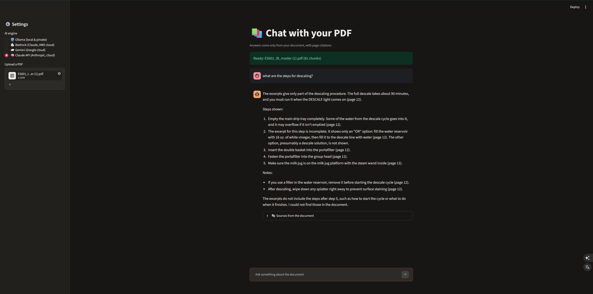
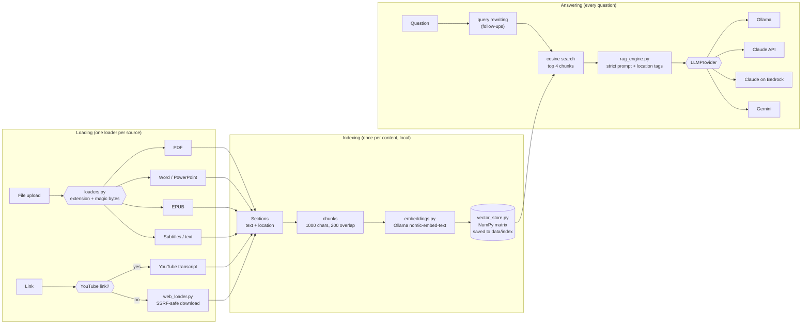

# 📚 Hybrid RAG Document Chat

[](https://github.com/Liviu1342/hybrid-rag-pdf-chat/actions/workflows/tests.yml)

Chat with your own documents, e-books, videos and web pages. Every answer comes **only from your source**, with **precise citations** (page, minute, slide, section) and the exact passages it used. Retrieval runs **100% locally with Ollama**, so your content never leaves your machine; the answer can be written by a local model or by Claude / Gemini in the cloud.



## ✨ Features

- **Many sources, one pipeline** – PDF, Word, PowerPoint, EPUB e-books, plain text, `.srt` / `.vtt` subtitles, YouTube videos and public web pages.
- **Automatic source detection** – upload a file or paste a link: the app picks the right loader from the extension (checked against the file's content) or recognizes a YouTube link.
- **Precise citations** – `(page 12)` for PDFs, `(05:30)` for videos with a clickable link that opens the video at that minute, `(slide 7)` for slides, `(Refund policy, paragraph 4)` for Word, e-books and web pages.
- **Retrieval-Augmented Generation (RAG)** built from first principles: chunking, embeddings, cosine-similarity search and grounded generation.
- **Private by design** – text and embeddings are computed and stored locally (Ollama `nomic-embed-text`). Only the question and the 4 most relevant excerpts are sent to a cloud model, and only if you choose one.
- **Four interchangeable answer engines** behind one `LLMProvider` interface: Ollama (local), Claude via the Anthropic API, Claude on Amazon Bedrock and Google Gemini.
- **Anti-hallucination prompt** – if the answer is not in the source, the model says so instead of guessing.
- **Conversation memory (query rewriting)** – follow-ups like "explain that more simply" are rewritten into a standalone question before searching; the app shows what it searched for.
- **Index cache keyed by content** – a 974-page book is indexed once (~85 s on a laptop GPU) and reloaded in 0.4 s afterwards.
- **Live streaming** – answers appear word by word.

## 📂 Supported sources

| Source | How it is split | Citation example |
| --- | --- | --- |
| PDF | one section per page | `(page 12)` |
| Word `.docx` | at every heading, and every 20 paragraphs | `(Refund policy, paragraph 4)` |
| PowerPoint `.pptx` | one section per slide, including speaker notes | `(slide 7)` |
| E-book `.epub` | chapters in reading order, at every heading | `(Chapter 3, paragraph 12)` |
| Subtitles `.srt` / `.vtt` | one section per minute of speech | `(05:30)` |
| YouTube link | transcript with timestamps, one section per minute | `(05:30)` + ▶️ link to that moment |
| Web page link | article text without menus and footers, at every heading | `(Getting started, paragraph 2)` |
| Plain text `.txt` | blocks of 40 lines | `(lines 41-80)` |

Word, e-books and web pages have no fixed pages (they reflow with the font size), so they are cited by the nearest heading and paragraph number instead of a page that would not exist.

## 🏗️ How it works



1. **Load** – every loader has the same shape, `bytes -> list[Section]`, where a `Section` is a piece of text plus a human-readable location (`"page 12"`, `"05:30"`, `"slide 7"`). The rest of the pipeline never knows which format it came from.
2. **Chunk** – each section is split into overlapping chunks, so a chunk never mixes two locations and citations stay exact.
3. **Embed** – each chunk becomes a 768-number vector that captures its meaning.
4. **Retrieve** – the question is embedded the same way; one matrix multiplication scores every chunk, and the 4 best are kept.
5. **Generate** – the chunks are wrapped in `<excerpt location="...">` tags inside a `<context>` block, with rules: use only the excerpts, cite the location, say "I could not find this in the document." otherwise.

## 🧠 Design decisions

| Decision | Why |
| --- | --- |
| One `Section(text, location)` type for every source | Loaders are independent strategies; chunking, search and prompts are shared. Adding a format means one function plus one line in the `LOADERS` registry. |
| Location as a string, not a page number | A minute of video, a slide or a heading is not a page. The model cites whatever the excerpt tag says. |
| One-minute windows for transcripts | One minute of speech (~900 characters) is about one chunk, so a `(05:30)` citation points at the right moment. |
| NumPy instead of FAISS / Chroma | One document is a few thousand vectors: a single matrix product searches them in milliseconds. It keeps the math visible and avoids native dependencies. |
| Index folder named by a SHA-256 of the content | If a file or web page changes, the hash changes and it is re-indexed automatically. An `INDEX_VERSION` prefix rebuilds old indexes after a format change. |
| Embedding model name stored with the vectors | Vectors from different models are not comparable; loading an index built with another model is refused. |
| JSON + `.npy` instead of `pickle` | Loading a pickle file can execute code; these formats contain only data. |
| `LLMProvider` protocol + factory | The RAG logic depends on an interface, not on a vendor. Adding a provider means one new class. |

## 📊 Results on a real document

Test document: a 974-page medical textbook (musculoskeletal ultrasound), on a laptop with an NVIDIA GPU (8 GB VRAM).

| Metric | Value |
| --- | --- |
| Pages with text | 974 |
| Chunks (1000 / 200) | 4,011 |
| First indexing (local embeddings) | ~85 s |
| Loading the cached index | 0.4 s |
| Off-topic question ("Who won the World Cup in 1945?") | "I could not find this in the document." |

## 🛠️ Tech stack

Python 3.11+ · Streamlit · pypdf · python-docx · python-pptx · EbookLib · youtube-transcript-api · requests · LangChain text splitters · NumPy · Ollama (`nomic-embed-text`, `llama3.1:8b`) · Anthropic SDK (Claude API and Amazon Bedrock) · Google Gen AI SDK (Gemini) · pytest · GitHub Actions

## 🚀 Getting started

### Prerequisites

- Python 3.11 or newer
- [Ollama](https://ollama.com/download), with both models pulled:
  ```bash
  ollama pull nomic-embed-text
  ollama pull llama3.1:8b
  ```
- *(Optional)* credentials for a cloud engine: an Anthropic API key, AWS access keys with Bedrock access, or a Gemini API key.

### Installation

```bash
git clone https://github.com/Liviu1342/hybrid-rag-pdf-chat.git
cd hybrid-rag-pdf-chat
python -m venv venv          # macOS: python3.13 -m venv venv
```

Activate the virtual environment:

- **Windows (PowerShell):** `.\venv\Scripts\Activate.ps1`
- **macOS / Linux:** `source venv/bin/activate`

```bash
pip install -r requirements.txt
cp .env.example .env        # Windows: Copy-Item .env.example .env
```

Fill in `.env` only for the cloud engines you want to use. Local mode needs no keys.

### Run

```bash
streamlit run app.py
```

Upload a file or paste a link (YouTube video or web page) in the sidebar, wait for indexing (first time only), then ask questions.

## ⚙️ Configuration

| Variable | Description | Default |
| --- | --- | --- |
| `OLLAMA_HOST` | Address of the Ollama server | `http://localhost:11434` |
| `OLLAMA_MODEL` | Local chat model | `llama3.1:8b` |
| `OLLAMA_EMBED_MODEL` | Local embedding model | `nomic-embed-text` |
| `ANTHROPIC_API_KEY` | Anthropic API key (**never commit it**) | – |
| `ANTHROPIC_MODEL` | Claude model on the Anthropic API | `claude-sonnet-5-5` |
| `AWS_ACCESS_KEY_ID` / `AWS_SECRET_ACCESS_KEY` | AWS keys with Bedrock access (**never commit them**) | – |
| `AWS_REGION` | Bedrock region | `eu-north-1` |
| `BEDROCK_MODEL` | Claude model ID on Bedrock | `eu.anthropic.claude-sonnet-4-6` |
| `GEMINI_API_KEY` | Gemini API key (**never commit it**) | – |
| `GEMINI_MODEL` | Gemini model name | – |

## 🧪 Tests

```bash
pip install -r requirements-dev.txt
python -m pytest -v
```

60 tests run in about two seconds with no Ollama, GPU, API keys or internet: they use a fake embedder, a fake LLM, a fake DNS and a fake website, and build Word, PowerPoint and EPUB files in memory. GitHub Actions runs them on every push.

## 📁 Project structure

```text
├── app.py               # Streamlit chat UI and provider factory
├── rag_engine.py        # Strict prompt, query rewriting, retrieval + generation
├── vector_store.py      # NumPy vector store, save/load, index cache per source
├── embeddings.py        # EmbeddingProvider contract + Ollama implementation
├── documents.py         # Section and Chunk types, chunking, heading-based grouping
├── loaders.py           # Loader registry: file type detection + magic-byte checks
├── pdf_loader.py        # PDF, one section per page
├── office_loader.py     # Word (.docx) and PowerPoint (.pptx)
├── epub_loader.py       # EPUB e-books
├── html_text.py         # Safe HTML-to-text parser (standard library only)
├── subtitle_loader.py   # .srt / .vtt subtitles, one-minute windows
├── text_loader.py       # Plain text, blocks of 40 lines
├── youtube_loader.py    # YouTube transcripts with timestamps
├── web_loader.py        # SSRF-safe web page download
├── providers.py         # LLMProvider contract + Ollama, Anthropic, Bedrock, Gemini
├── tests/               # pytest suite, no network needed
└── .env.example         # Configuration template (copy to .env)
```

## 🔒 Security & privacy

- **Secrets** live only in `.env`, which is excluded by `.gitignore`.
- **Local data** – uploaded files and indexes (which contain the full text) are stored under `data/`, also git-ignored. In local mode, nothing leaves your machine; with a cloud engine, only the question and 4 excerpts are sent.
- **SSRF protection for links** – only `http`/`https`; every address the host name resolves to must be public (no `localhost`, private networks or the cloud metadata service `169.254.169.254`); redirects are followed manually and each one is checked again; downloads are limited to 5 MB and 10 seconds, and only HTML or text is accepted.
- **File type checks** – the extension must match the content's magic bytes (`%PDF` for PDF, a ZIP header for Word, PowerPoint and EPUB, no binary bytes in text files), so a renamed executable is refused before any parser sees it.
- **No code from documents is run** – HTML from e-books and web pages is read with the standard-library parser; scripts and styles are skipped, never executed.
- **Prompt-injection guard** – source text is passed inside `<context>` tags and declared as data, never as instructions. Menus, scripts and styles are removed first, so less hidden text reaches the model.
- **Path traversal guard** – uploaded file names are reduced to their base name before saving.
- **No pickle** – the index is stored as JSON + NumPy arrays, which cannot execute code when loaded.

## ⚠️ Limitations

- Scanned PDFs (images without a text layer) are not supported yet; they would need OCR.
- Web pages built in the browser by JavaScript (many single-page apps) contain almost no text in their HTML and cannot be read without a headless browser.
- The SSRF check resolves the host name before the request library connects; a malicious DNS server could answer differently the second time (DNS rebinding). Running behind an egress proxy closes this gap.
- Tables in Word files, and questions that need calculations over tables (`.csv`, `.xlsx`), are not supported: aggregates need SQL or code execution rather than text retrieval.
- Requests about the previous answer (translate it, summarize it) still trigger a new search, so sources may shift slightly.
- Purely semantic search can miss exact codes or identifiers (e.g. "ERR-4471").

## 🗺️ Roadmap

- [x] Conversation memory via query rewriting (turn follow-ups into standalone questions)
- [x] Multiple sources: Word, PowerPoint, EPUB, subtitles, YouTube, web pages, plain text
- [ ] Intent routing: answer "translate / summarize the previous answer" without a new search
- [ ] Several sources in one conversation
- [ ] Hybrid search: semantic + keyword (BM25)
- [ ] OCR for scanned PDFs
- [ ] Cloud embeddings option (e.g. Amazon Titan on Bedrock)
- [ ] C# / .NET port with Microsoft.Extensions.AI

## 📄 License

MIT – see [LICENSE](LICENSE).
