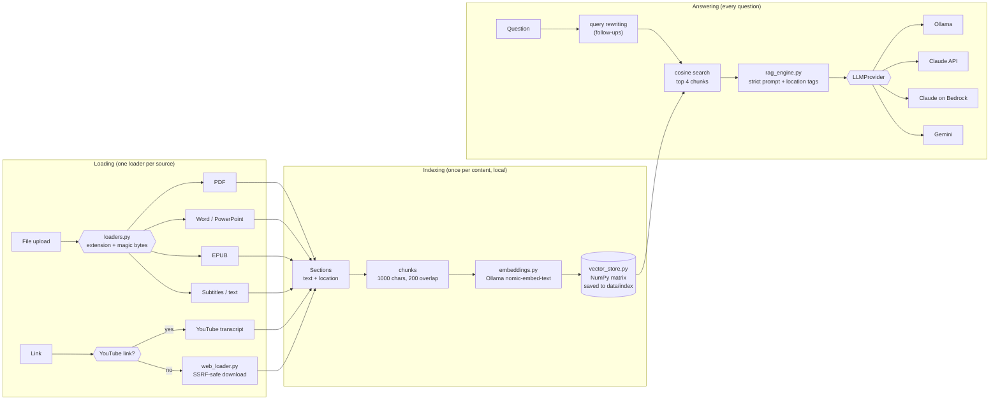

# 📚 Hybrid RAG PDF Chat

Chat with your own documents, e-books, videos and web pages. Every answer comes **only from your source**, with **precise citations** (page, minute, slide, section) and the exact passages it used. Retrieval runs **100% locally with Ollama**, so your content never leaves your machine; the answer can be written by a local model or by Claude / Gemini in the cloud.

## ✨ Features

- **Many sources, one pipeline** – PDF, Word, PowerPoint, EPUB e-books, plain text, `.srt` / `.vtt` subtitles, YouTube videos and public web pages.
- **Automatic source detection** – upload a file or paste a link: the app picks the right loader from the extension (checked against the file's content) or recognizes a YouTube link.
- **Precise citations** – `(page 12)` for PDFs, `(05:30)` for videos with a clickable link that opens the video at that minute, `(slide 7)` for slides, `(Refund policy, paragraph 4)` for Word, e-books and web pages.
- **Retrieval-Augmented Generation (RAG)** built from first principles: chunking, embeddings, cosine-similarity search and grounded generation.
- **Private by design** – text and embeddings are computed and stored locally (Ollama `nomic-embed-text`). Only the question and the 4 most relevant excerpts are sent to a cloud model, and only if you choose one.
- **Four interchangeable answer engines** behind one `LLMProvider` interface: Ollama (local), Claude via the Anthropic API, Claude on Amazon Bedrock and Google Gemini.
- **Anti-hallucination prompt** – if the answer is not in the source, the model says so instead of guessing.
- **Conversation memory (query rewriting)** – follow-ups like "explain that more simply" are rewritten into a standalone question before searching; the app shows what it searched for.
- **Index cache keyed by content** – a 974-page book is indexed once (~85 s on a laptop GPU) and reloaded in 0.4 s afterwards.
- **Live streaming** – answers appear word by word.

## 📂 Supported sources

| Source | How it is split | Citation example |
| --- | --- | --- |
| PDF | one section per page | `(page 12)` |
| Word `.docx` | at every heading, and every 20 paragraphs | `(Refund policy, paragraph 4)` |
| PowerPoint `.pptx` | one section per slide, including speaker notes | `(slide 7)` |
| E-book `.epub` | chapters in reading order, at every heading | `(Chapter 3, paragraph 12)` |
| Subtitles `.srt` / `.vtt` | one section per minute of speech | `(05:30)` |
| YouTube link | transcript with timestamps, one section per minute | `(05:30)` + ▶️ link to that moment |
| Web page link | article text without menus and footers, at every heading | `(Getting started, paragraph 2)` |
| Plain text `.txt` | blocks of 40 lines | `(lines 41-80)` |

Word, e-books and web pages have no fixed pages (they reflow with the font size), so they are cited by the nearest heading and paragraph number instead of a page that would not exist.

## 🏗️ How it works

1. **Load** – every loader has the same shape, `bytes -> list[Section]`, where a `Section` is a piece of text plus a human-readable location (`"page 12"`, `"05:30"`, `"slide 7"`). The rest of the pipeline never knows which format it came from.
2. **Chunk** – each section is split into overlapping chunks, so a chunk never mixes two locations and citations stay exact.
3. **Embed** – each chunk becomes a 768-number vector that captures its meaning.
4. **Retrieve** – the question is embedded the same way; one matrix multiplication scores every chunk, and the 4 best are kept.
5. **Generate** – the chunks are wrapped in `<excerpt location="...">` tags inside a `<context>` block, with rules: use only the excerpts, cite the location, say "I could not find this in the document." otherwise.

## 🧠 Design decisions

| Decision | Why |
| --- | --- |
| One `Section(text, location)` type for every source | Loaders are independent strategies; chunking, search and prompts are shared. Adding a format means one function plus one line in the `LOADERS` registry. |
| Location as a string, not a page number | A minute of video, a slide or a heading is not a page. The model cites whatever the excerpt tag says. |
| One-minute windows for transcripts | One minute of speech (~900 characters) is about one chunk, so a `(05:30)` citation points at the right moment. |
| NumPy instead of FAISS / Chroma | One document is a few thousand vectors: a single matrix product searches them in milliseconds. It keeps the math visible and avoids native dependencies. |
| Index folder named by a SHA-256 of the content | If a file or web page changes, the hash changes and it is re-indexed automatically. An `INDEX_VERSION` prefix rebuilds old indexes after a format change. |
| Embedding model name stored with the vectors | Vectors from different models are not comparable; loading an index built with another model is refused. |
| JSON + `.npy` instead of `pickle` | Loading a pickle file can execute code; these formats contain only data. |
| `LLMProvider` protocol + factory | The RAG logic depends on an interface, not on a vendor. Adding a provider means one new class. |
