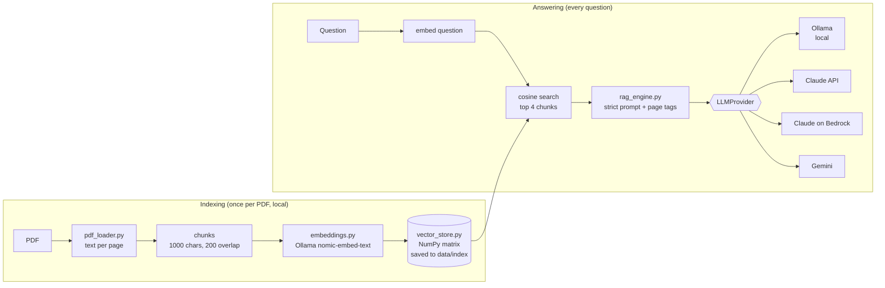

# 📚 Hybrid RAG PDF Chat

[](https://github.com/Liviu1342/hybrid-rag-pdf-chat/actions/workflows/tests.yml)

Chat with your own PDF documents. Every answer comes **only from the document**, with **page citations** and the exact source passages. Retrieval runs **100% locally with Ollama**, so the document never leaves your machine; the answer can be written by a local model or by Claude / Gemini in the cloud.


## ✨ Features

- **Retrieval-Augmented Generation (RAG)** built from first principles: chunking, embeddings, cosine-similarity search and grounded generation.
- **Private by design** – PDF text and embeddings are computed and stored locally (Ollama `nomic-embed-text`). Only the question and the 4 most relevant excerpts are sent to a cloud model, and only if you choose one.
- **Four interchangeable answer engines** behind one `LLMProvider` interface: Ollama (local), Claude via the Anthropic API, Claude on Amazon Bedrock and Google Gemini.
- **Page citations + verifiable sources** – every answer cites `(page N)` and shows the exact passages it used.
- **Anti-hallucination prompt** – if the answer is not in the document, the model says so instead of guessing.
- **Index cache keyed by content** – a 974-page book is indexed once (~85 s on a laptop GPU) and reloaded in 0.4 s afterwards.
- **Live streaming** – answers appear word by word.

## 🏗️ How it works



1. **Load & chunk** – the text of each page is split into overlapping chunks, so each chunk belongs to exactly one page and citations are always exact.
2. **Embed** – each chunk becomes a 768-number vector that captures its meaning.
3. **Retrieve** – the question is embedded the same way; one matrix multiplication scores every chunk, and the 4 best are kept.
4. **Generate** – the chunks are wrapped in `<excerpt page="N">` tags inside a `<context>` block, with rules: use only the excerpts, cite pages, say "I could not find this in the document." otherwise.

## 🧠 Design decisions

| Decision | Why |
| --- | --- |
| NumPy instead of FAISS / Chroma | One PDF is a few thousand vectors: a single matrix product searches them in milliseconds. It keeps the math visible and avoids native dependencies. The store sits behind a small interface, so FAISS can replace it later. |
| Chunking per page | A chunk never spans two pages, so `(page N)` citations are always correct. |
| Index folder named by the PDF's SHA-256 | If the file changes, the hash changes and the PDF is re-indexed automatically: no stale index. |
| Embedding model name stored with the vectors | Vectors from different models are not comparable; loading an index built with another model is refused. |
| JSON + `.npy` instead of `pickle` | Loading a pickle file can execute code; these formats contain only data. |
| `LLMProvider` protocol + factory | The RAG logic depends on an interface, not on a vendor. Adding a provider means one new class. |

## 📊 Results on a real document

Test document: a 974-page medical textbook (musculoskeletal ultrasound), on a laptop with an NVIDIA GPU (8 GB VRAM).

| Metric | Value |
| --- | --- |
| Pages with text | 974 |
| Chunks (1000 / 200) | 4,011 |
| First indexing (local embeddings) | ~85 s |
| Loading the cached index | 0.4 s |
| Off-topic question ("Who won the World Cup in 1945?") | "I could not find this in the document." |

## 🛠️ Tech stack

Python 3.11+ · Streamlit · pypdf · LangChain text splitters · NumPy · Ollama (`nomic-embed-text`, `llama3.1:8b`) · Anthropic SDK (Claude API and Amazon Bedrock) · Google Gen AI SDK (Gemini) · pytest · GitHub Actions

## 🚀 Getting started

### Prerequisites

- Python 3.11 or newer
- [Ollama](https://ollama.com/download), with both models pulled:
  ```bash
  ollama pull nomic-embed-text
  ollama pull llama3.1:8b
  ```
- *(Optional)* credentials for a cloud engine: an Anthropic API key, AWS access keys with Bedrock access, or a Gemini API key.

### Installation

```bash
git clone https://github.com/Liviu1342/hybrid-rag-pdf-chat.git
cd hybrid-rag-pdf-chat
python -m venv venv          # macOS: python3.13 -m venv venv
```

Activate the virtual environment:

- **Windows (PowerShell):** `.\venv\Scripts\Activate.ps1`
- **macOS / Linux:** `source venv/bin/activate`

```bash
pip install -r requirements.txt
cp .env.example .env        # Windows: Copy-Item .env.example .env
```

Fill in `.env` only for the cloud engines you want to use. Local mode needs no keys.

### Run

```bash
streamlit run app.py
```

Upload a PDF in the sidebar, wait for indexing (first time only), then ask questions.

## ⚙️ Configuration

| Variable | Description | Default |
| --- | --- | --- |
| `OLLAMA_HOST` | Address of the Ollama server | `http://localhost:11434` |
| `OLLAMA_MODEL` | Local chat model | `llama3.1:8b` |
| `OLLAMA_EMBED_MODEL` | Local embedding model | `nomic-embed-text` |
| `ANTHROPIC_API_KEY` | Anthropic API key (**never commit it**) | – |
| `ANTHROPIC_MODEL` | Claude model on the Anthropic API | `claude-sonnet-5-5` |
| `AWS_ACCESS_KEY_ID` / `AWS_SECRET_ACCESS_KEY` | AWS keys with Bedrock access (**never commit them**) | – |
| `AWS_REGION` | Bedrock region | `eu-north-1` |
| `BEDROCK_MODEL` | Claude model ID on Bedrock | `eu.anthropic.claude-sonnet-4-6` |
| `GEMINI_API_KEY` | Gemini API key (**never commit it**) | – |
| `GEMINI_MODEL` | Gemini model name | – |

## 🧪 Tests

```bash
pip install -r requirements-dev.txt
python -m pytest -v
```

The tests use a fake embedder and a fake LLM, so they run in about a second with no Ollama, GPU or API keys. GitHub Actions runs them on every push.

## 📁 Project structure

```text
├── app.py              # Streamlit chat UI and provider factory
├── rag_engine.py       # Strict prompt, retrieval + generation
├── vector_store.py     # NumPy vector store, save/load, index cache
├── embeddings.py       # EmbeddingProvider contract + Ollama implementation
├── pdf_loader.py       # PDF text per page and chunking
├── providers.py        # LLMProvider contract + Ollama, Anthropic, Bedrock, Gemini
├── tests/              # pytest suite with fake embedder and fake LLM
└── .env.example        # Configuration template (copy to .env)
```

## 🔒 Security & privacy

- Secrets live only in `.env`, which is excluded by `.gitignore`.
- Uploaded PDFs and indexes (which contain the full document text) are stored under `data/`, also git-ignored.
- In local mode, nothing leaves your machine. With a cloud engine, only the question and 4 excerpts are sent.
- **Prompt-injection guard** – document text is passed inside `<context>` tags and declared as data, never as instructions.
- **Path traversal guard** – uploaded file names are reduced to their base name before saving.
- **No pickle** – the index is stored as JSON + NumPy arrays, which cannot execute code when loaded.

## ⚠️ Limitations

- Scanned PDFs (images without a text layer) are not supported yet; they would need OCR.
- Each question is answered on its own: follow-ups like "explain that more simply" do not see the previous turn yet.
- Purely semantic search can miss exact codes or identifiers (e.g. "ERR-4471").

## 🗺️ Roadmap

- [ ] Conversation memory via query rewriting (turn follow-ups into standalone questions)
- [ ] Hybrid search: semantic + keyword (BM25)
- [ ] OCR for scanned PDFs
- [ ] Cloud embeddings option (e.g. Amazon Titan on Bedrock)
- [ ] C# / .NET port with Microsoft.Extensions.AI
